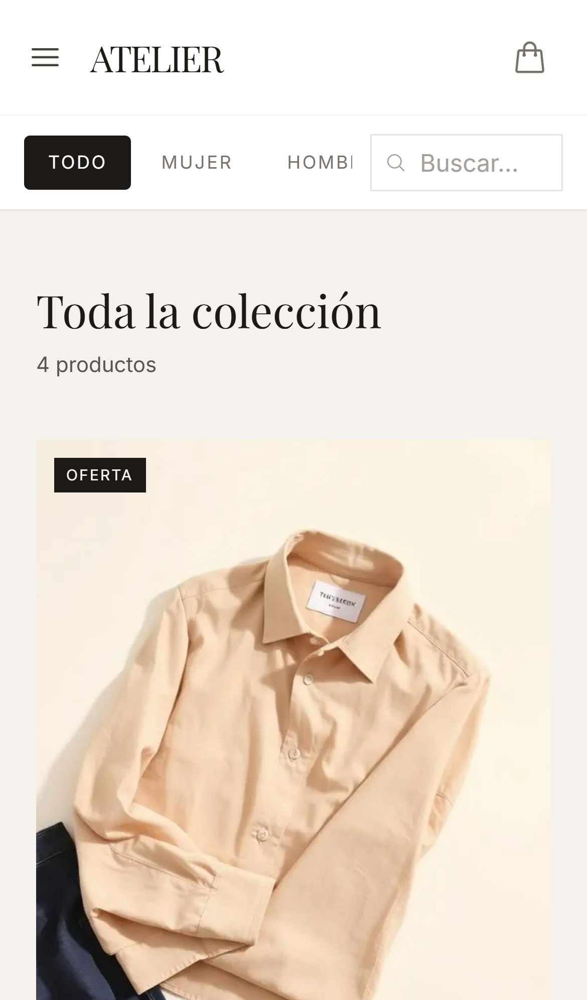
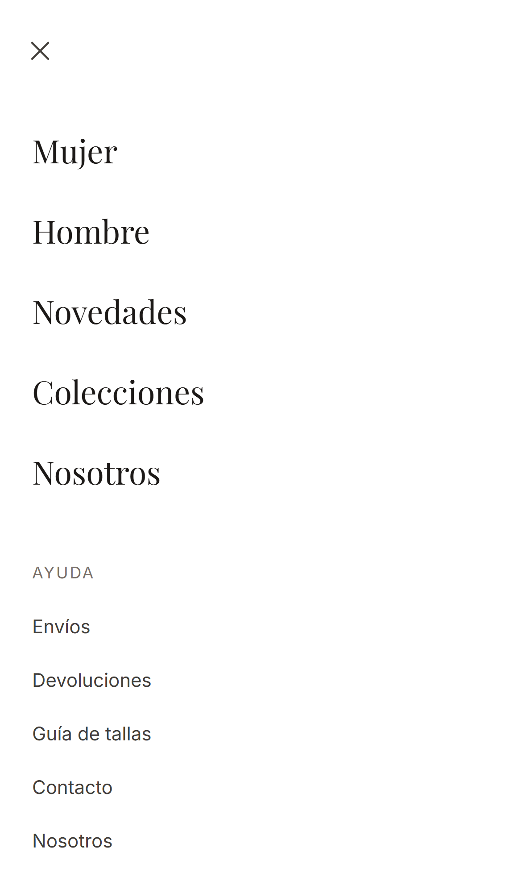
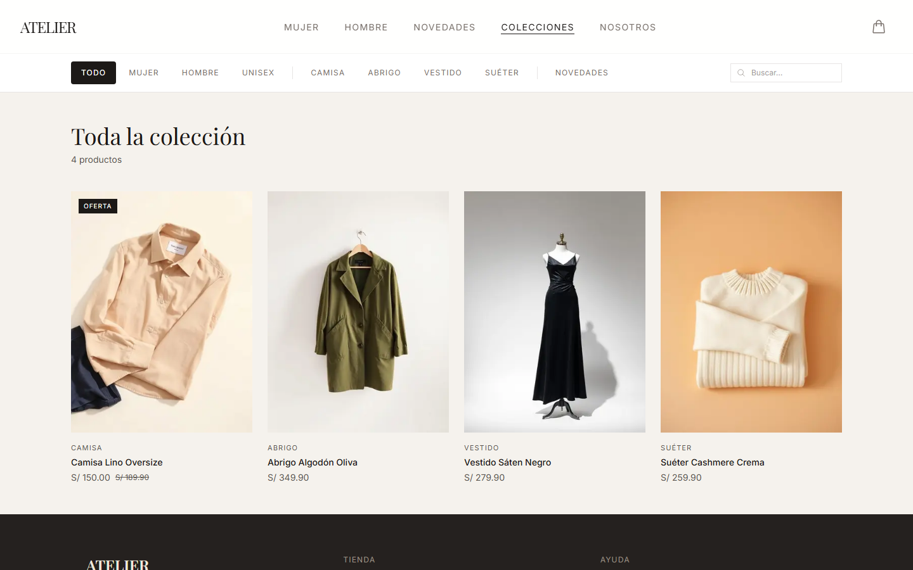
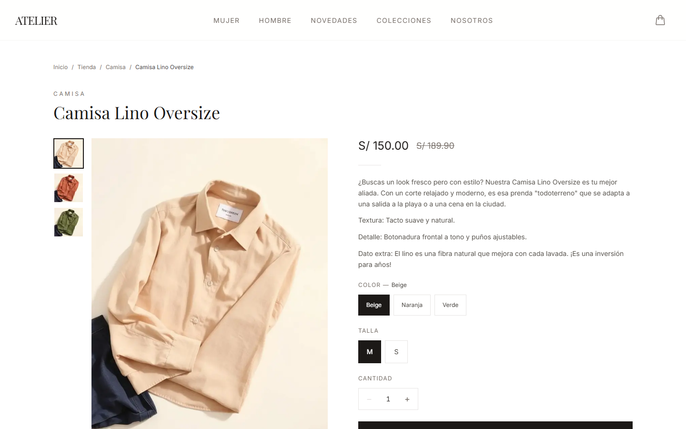
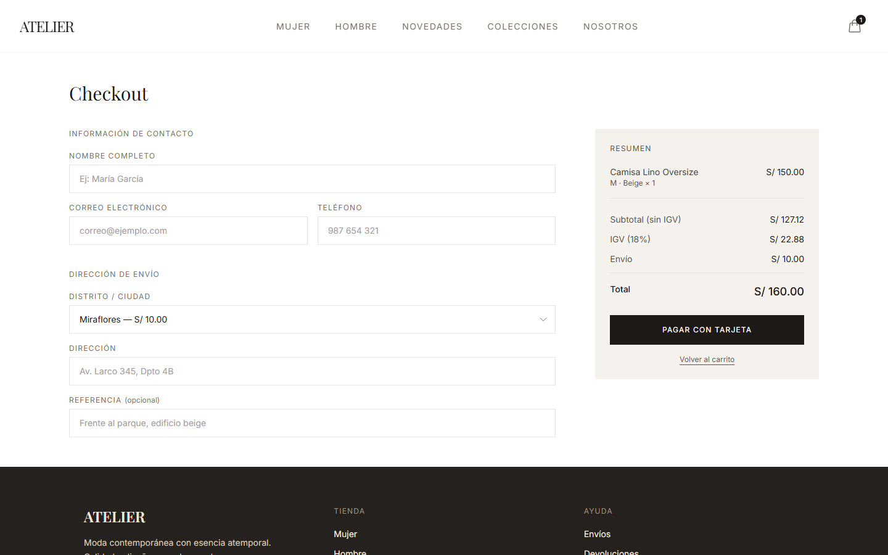

# ATELIER — Tienda de ropa online

[](https://github.com/Fufexo/Atelier-Web-Publica/actions/workflows/ci.yml)

E-commerce de moda para el mercado peruano: catálogo con filtros, carrito, checkout con pago real con tarjeta (Culqi), envío por distrito, panel de administración y emails de confirmación. Next.js 16 + React 19 sobre Supabase.

**Demo en vivo → [atelier-ropa.vercel.app](https://atelier-ropa.vercel.app)**


<p align="center">
  
  &nbsp;&nbsp;
  
  &nbsp;&nbsp;
  
</p>

## Qué tiene

### Tienda

- **Catálogo con filtros** por género, categoría y novedades, más búsqueda con debounce. Los filtros viven en la URL (se comparten y funcionan con atrás/adelante) y se marcan al instante con `useOptimistic` mientras llegan los productos.
- **Carrusel con snap en celular y grilla desde tablet**, en una sola lista: no hay una copia del DOM por breakpoint.
- **Ficha de producto** con galería, selector de color y talla sincronizado con las imágenes, stock por variante y aviso de últimas unidades. Al abrirla, la foto de la card "viaja" a la ficha con `<ViewTransition>` de React.
- **Carrito persistente** en `localStorage`, sincronizado entre pestañas y tolerante a datos corruptos o almacenamiento bloqueado.
- Páginas de ayuda (envíos, devoluciones, guía de tallas con cm/pulgadas, contacto) y una página "Nosotros" editorial.





### Checkout y pagos

- **Envío por distrito** de Lima Metropolitana (S/ 10–25) o a provincia, con la tarifa visible antes de pagar.
- **Validación con el mismo esquema** (Zod) en el navegador y en el servidor: cada error aparece junto a su campo y el foco va al primero.
- **Pago con tarjeta vía Culqi.** La tarjeta se tokeniza en el navegador; el servidor solo recibe el token.
- **El servidor decide cuánto cobrar:** recalcula precios, stock, envío y total desde la base. Si el carrito quedó desactualizado, no cobra y lo corrige solo.
- **Email de confirmación** al cliente y aviso al admin, enviados después de responder.



### Panel de administración (`/admin`)

- Acceso solo para cuentas registradas como administradoras, verificado en la base de datos (RLS), no solo en la interfaz.
- **Dashboard** con pedidos y ventas del día (en hora de Lima) y últimos pedidos.
- **Productos:** imágenes, variantes de talla/color con stock, precio de oferta, destacados, orden manual, publicar/ocultar y borrado masivo. Alerta de stock bajo.
- **Categorías** con portada, **pedidos** filtrables por estado con cambio de estado, y **analíticas** de 30 días: ingresos diarios, ticket promedio y productos más vendidos, con un gráfico SVG propio y vista de tabla accesible.
- Modo oscuro.

## Stack

| | |
|---|---|
| Framework | Next.js 16: App Router, Server Components, Server Actions, `proxy.ts` |
| UI | React 19.3: `useOptimistic`, `useActionState`, `useSyncExternalStore`, `<ViewTransition>` |
| Estilos | Tailwind CSS v4 con tokens de diseño en `@theme` |
| Datos | Supabase: PostgreSQL con RLS, Auth y Storage; tipos generados desde el esquema |
| Validación | Zod 4, compartido entre navegador y servidor |
| Pagos | Culqi (tokenización en el navegador, cargo en el servidor) |
| Emails | Gmail SMTP con Nodemailer (o Resend con dominio propio) |
| Tests | Vitest · axe-core · Lighthouse · GitHub Actions |
| Deploy | Vercel |

## Decisiones técnicas

- **El servidor decide cuánto cobrar.** `POST /api/culqi/cobrar` recibe qué variantes, cuántas y a qué distrito; lee precios y stock con el service role y arma el pedido con una función pura (`lib/checkout/armar-pedido.ts`). Si el total que vio el cliente no coincide (precio cambiado o petición manipulada), no cobra y devuelve el precio y stock actuales para que el carrito se actualice solo.
- **Pedido atómico, con compensación.** La función SQL `registrar_pedido_pagado` inserta el pedido, sus ítems y el pago y descuenta el stock en una sola transacción: o queda todo o nada. Como el cobro ocurre antes (Culqi no participa de la transacción), si el registro falla el cargo se reembolsa automáticamente.
- **Autorización en la base, no solo en la UI.** Las políticas RLS usan `es_admin()` sobre una tabla `admins`: tener cuenta en Supabase Auth no da acceso a nada. `proxy.ts` exige sesión en `/admin`, y `requireAdmin()` (memoizada por request) vuelve a verificar el rol en el layout y en cada Server Action, que además valida sus argumentos con Zod.
- **Una capa de datos tipada.** Las consultas de la tienda viven en `lib/catalogo.ts`; los clientes de Supabase usan el tipo `Database` generado desde el esquema, y las columnas JSONB (`imagenes`, `direccion_envio`) se validan al leerlas.
- **Lógica de negocio pura y testeada.** IGV y totales, tarifas de envío, carrito, armado del pedido, fechas en hora de Lima y analíticas son funciones sin React ni red; los componentes solo las muestran.
- **Carrito como store externo.** `useSyncExternalStore` sobre `localStorage` reemplaza el patrón "leer en `useEffect` y hacer `setState`", que en StrictMode podía pisar el carrito guardado con uno vacío.
- **Variantes con identidad estable.** Editar un producto actualiza sus variantes por `id` en vez de borrarlas y recrearlas, así no se rompen carritos abiertos ni el vínculo de pedidos anteriores. Cada variante guarda además su posición (`orden`): de ella depende qué foto corresponde a cada color, y no cambia aunque se venda stock.
- **Componentes reutilizables.** Primitivas en `components/ui` (`Icon`, `boton()`, `Field`, `QuantityStepper`, `PageHeader`, `EmptyState`), piezas de tienda (`ProductCard`, `ProductGrid`, `ResumenTotales`, `PaginaInfo`) y del panel (`Card`, badges de estado). Un layout por sección (`app/(tienda)`, `app/admin`) evita repetir la estructura en cada página.
- **Animación sin JavaScript.** Las apariciones al hacer scroll son CSS (`animation-timeline: view()`): el contenido llega visible en el HTML y, sin soporte o con movimiento reducido, simplemente no se anima.
- **Rendimiento.** `next/image` (AVIF/WebP, `sizes`, `preload` en el hero), íconos SVG inline en vez de una fuente de íconos externa, fuentes con `next/font`, y `proxy.ts` limitado a `/admin` y `/login`, así la tienda pública no consulta Auth en cada request.
- **Fechas en hora de Lima.** "Hoy" y los días del gráfico se calculan en `America/Lima`, no en la hora del servidor (UTC en Vercel).
- **SEO.** Metadata y `canonical` por página, Open Graph, datos estructurados `schema.org/Product`, `sitemap.xml` con los productos activos, `robots.txt` y `noindex` en carrito, checkout, búsquedas y panel.

## Calidad

- **42 tests unitarios** (Vitest): IGV y totales, envíos, carrito (incluida la sincronización con el servidor), armado del pedido y esquema del checkout, escape de HTML y proveedor de emails, fechas en Lima, analíticas, navegación y parseo de JSONB.
- **Prueba de punta a punta** contra un Supabase local (`supabase start`) con Culqi en modo prueba: login y permisos, alta de producto con fotos y variantes, compra con tarjeta de prueba, stock, total manipulado, precio cambiado durante el pago, reembolso automático si falla el registro, gestión del pedido y borrado.
- **Migraciones probadas contra un Postgres real**: políticas de admin y no admin, Storage, la transacción del pedido (incluido el rollback por falta de stock) e idempotencia.
- **axe-core** (WCAG 2.1 AA): 0 violaciones en inicio, tienda, producto, carrito y checkout. Labels conectados, foco visible, menú con <kbd>Esc</kbd> y retorno del foco, enlace "saltar al contenido".
- **CI** en GitHub Actions en cada push: formato, lint, tipos, tests y build.
- **Lighthouse** sobre producción, inicio:

| | Rendimiento | Accesibilidad | Buenas prácticas | SEO |
|---|:---:|:---:|:---:|:---:|
| Móvil | 88–94 | 100 | 100 | 100 |
| Escritorio | 100 | 100 | 100 | 100 |

## Estructura

```
app/
├── (tienda)/              # tienda pública: un layout con Navbar y Footer
│   ├── page.tsx           #   inicio
│   ├── tienda/            #   catálogo y filtros
│   ├── producto/[slug]/   #   ficha + JSON-LD
│   ├── carrito/  checkout/
│   └── envios/  devoluciones/  contacto/  nosotros/  guia-de-tallas/
├── admin/                 # panel: requireAdmin() en el layout y en cada acción
├── api/culqi/cobrar/      # cobra y registra el pedido
├── login/
└── sitemap.ts  robots.ts  not-found.tsx
components/
├── ui/                    # Icon, boton(), Field, QuantityStepper, PageHeader, EmptyState
├── store/                 # Navbar, Footer, ProductCard, ProductGrid, ResumenTotales, Reveal…
└── admin/                 # ui.tsx (Card, badges, estilos), ProductoForm, VariantesEditor…
lib/
├── supabase/              # clientes server / browser / admin + database.types.ts
├── checkout/              # schema (Zod) y armar-pedido (puro) + tests
├── carrito/               # lógica pura + store
├── catalogo.ts            # consultas de la tienda
├── auth.ts                # requireAdmin()
├── precios.ts  envios.ts  pedidos.ts  format.ts  analiticas.ts
└── culqi.ts  email.ts  navigation.ts  site.ts  types.ts
supabase/migrations/       # 001 → 009
```

## Correr el proyecto

Requiere **Node 22 o superior** y un proyecto de Supabase.

```bash
cp .env.example .env.local   # completar valores
npm install
npm run dev                  # http://localhost:3000
```

| Script | |
|---|---|
| `npm run dev` | servidor de desarrollo |
| `npm run check` | lint + tipos + tests |
| `npm test` | tests unitarios |
| `npm run format` | Prettier (con orden de clases de Tailwind) |
| `npm run build` | build de producción |

**Base de datos.** Aplica las migraciones de `supabase/migrations/` en orden (SQL Editor o `supabase db push`). Para dar acceso al panel a un usuario de Supabase Auth:

```sql
insert into public.admins (user_id) values ('<uuid del usuario>');
```

Después de cambiar el esquema, regenera los tipos: `npx supabase gen types typescript --project-id <id> > lib/supabase/database.types.ts`.

**Pagos.** Usa las llaves de integración de Culqi y sus tarjetas de prueba.

**Emails.** Con Gmail: activa la verificación en dos pasos, crea una [contraseña de aplicación](https://myaccount.google.com/apppasswords) y define `GMAIL_USER` y `GMAIL_APP_PASSWORD`. Sin ninguna configuración, los pedidos se registran igual y solo se omiten los emails.

## Próximos pasos

- Tests end-to-end con Playwright dentro del repo (hoy se corren contra producción fuera de él).
- Pago con Yape y Plin (el esquema ya los contempla).
- Seguimiento de pedido para el cliente con su número y email.
- Panel admin adaptado a celular y orden de imágenes por arrastre.

## Autor

**Fufexo** — [github.com/Fufexo](https://github.com/Fufexo)
